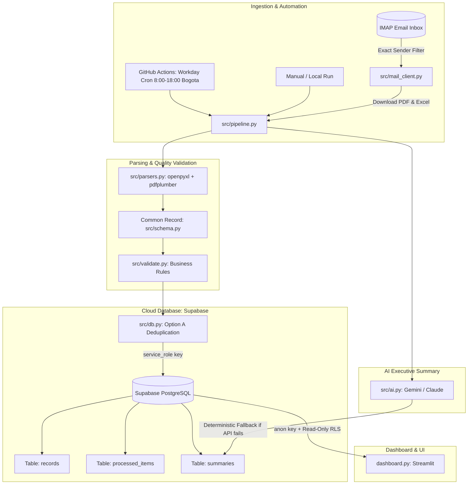

# Operational Automation Solution: Email, AI & Dashboard (Python + Supabase + Streamlit)

An automated and functional end-to-end solution designed to receive, process, validate, and display operational reports sent by email (Excel `.xlsx` and PDF formats). The solution uses **Supabase (PostgreSQL)** for cloud persistence, **AI (Google Gemini / Anthropic Claude)** for executive summaries, and **Streamlit** for real-time interactive dashboards.

---

## 1. System Architecture



---

## 2. Key Technical Decisions & Highlights

### Cloud Database & 3-Layer Deduplication (Supabase)
- **Centralized Storage:** Local SQLite files are deleted when running on ephemeral containers like GitHub Actions or Streamlit Cloud. Supabase provides a shared PostgreSQL database that connects both the background pipeline and the frontend.
- **Three Deduplication Layers:**
  1. **Email Layer:** `Message-ID` is verified so the same email is not downloaded again.
  2. **File Layer:** SHA-256 hash of each attachment prevents processing identical files twice.
  3. **Record Layer (`row_hash` PK):** Each row generates a unique SHA-256 signature (`date|client|category|value|status|reference`). Even if the same data arrives in a different file or email, duplicates are blocked at the database level.
- **Option A Counting:** Before saving new rows, the pipeline checks existing `row_hash` values in batches. This gives an exact count of new rows versus duplicate rows.

### Security & Principle of Least Privilege (RLS)
- **Ingestion Pipeline:** Uses `SUPABASE_SERVICE_KEY` only in secure server environments to insert rows and save audit logs.
- **Public Dashboard:** Uses `SUPABASE_ANON_KEY`. Row Level Security (RLS) policies only permit read-only `SELECT` access to `records`, `summaries`, and file logs. Email Message-IDs (`kind = 'mail'`) remain completely private.

### Practical & Safe Use of AI
- **Where AI is used:** To write a **3 to 4 sentence executive summary** in natural language. This saves managers from writing manual reports every cycle.
- **No Hallucinations:** The AI does not compute numbers. A `pandas` function calculates all metrics in Python first. The language model only receives exact JSON numbers and a strict system instruction not to invent data.
- **Automatic Fallback:** If the AI API key is missing, network fails, or quota is exceeded, the system generates a clear deterministic summary. The pipeline **never crashes** because of AI.
- **Deterministic Document Parsing:** Excel and PDF files are parsed using standard Python libraries (`openpyxl`, `pdfplumber`, regex). Standard programming is faster, 100% accurate, free of charge, and easy to unit test.

### Workday Automation Schedule
- Configured in `.github/workflows/ingest.yml` to run every hour between **8:00 AM and 6:00 PM Colombia time** (`0 13-23 * * *` in UTC).
- Night executions are avoided to save free GitHub Actions minutes. Any email received at night is processed automatically at 8:00 AM the next morning.

---

## 3. Dashboard Metrics & Alerts

The dashboard displays all required metrics plus justified extra indicators:

1. **Total Processed Records:** Total number of operational operations.
2. **Total Monetary Value:** Sum of all recorded transactions.
3. **Records by Category:** Distribution of operations across services or products (Bar Chart).
4. **Records by Status:** Percentage share of operational states (Donut Chart).
5. **Timeline Evolution:** Daily volume and monetary value trends (Time Series Chart).

### Justified Additional Metrics
6. **Average Ticket Size (`value.mean()`):** Shows the typical transaction size to detect abnormal variations.
7. **Completion Rate (`Completed / Total * 100`):** Measures the operational efficiency of the process.
8. **Records with Issues (`issues != ""`):** Key data quality indicator highlighting incomplete fields, negative values, or future dates.
9. **Unique Clients (`client.nunique()`):** Measures portfolio diversification.

### Proactive Visual Alerts
- **Warning Banner (`st.warning`):** Alert shown at the top of the screen when records have missing or invalid data, naming the affected source files.
- **Error Banner (`st.error`):** Red alert displayed if an attachment failed to read (e.g., corrupted file) with the technical reason.

---

## 4. Quick Start & Local Execution

### Step 1: Clone and Set Up Virtual Environment
```bash
python -m venv .venv

# On Windows:
.venv\Scripts\activate

# On Linux / macOS:
source .venv/bin/activate

pip install -r requirements.txt
```

### Step 2: Configure Supabase
1. Create a free project at [Supabase](https://supabase.com).
2. Open the **SQL Editor** in the Supabase dashboard and run the script in `supabase/schema.sql`.
3. Go to **Project Settings > API** and copy:
   - `Project URL` (`SUPABASE_URL`)
   - `anon public key` (`SUPABASE_ANON_KEY`)
   - `service_role secret key` (`SUPABASE_SERVICE_KEY`)

### Step 3: Set Up Environment Variables
Copy `.env.example` to `.env`:
```bash
cp .env.example .env
```
Fill in your credentials:
```env
SUPABASE_URL=https://your-project.supabase.co
SUPABASE_SERVICE_KEY=your_service_role_secret_key
SUPABASE_ANON_KEY=your_anon_public_key

# AI Provider (Optional - works with fallback if empty)
GOOGLE_API_KEY=your_gemini_api_key
GEMINI_MODEL=gemini-2.5-flash

# Email Ingestion (Optional for local demo)
IMAP_HOST=imap.gmail.com
IMAP_USER=your_email@gmail.com
IMAP_PASSWORD=your_16_letter_app_password
ALLOWED_SENDER=reports@company.com
```

### Step 4: Run the Ingestion Pipeline

#### Demo Mode (using included sample files in `data/samples/`):
```bash
python -m src.pipeline --local data/samples
```
*If you run this command a second time, already processed files and duplicate rows will be skipped automatically.*

#### Real Email Mode (IMAP):
```bash
python -m src.pipeline
```

### Step 5: Start the Interactive Dashboard
```bash
streamlit run dashboard.py
```
Open **http://localhost:8501** in your web browser.

### Step 6: Run Automated Tests
```bash
pytest -v
```
*Includes 20 automated tests verifying parsers, money/date formats, batch deduplication, error handling, and live Supabase integration.*

---

## 5. Free-Tier Deployment Guide

### 1. Ingestion Job (GitHub Actions)
1. Push this repository to GitHub.
2. In your GitHub repository, go to **Settings > Secrets and variables > Actions** and add:
   - `SUPABASE_URL`
   - `SUPABASE_SERVICE_KEY`
   - `IMAP_HOST`, `IMAP_USER`, `IMAP_PASSWORD`, `ALLOWED_SENDER`
   - `GOOGLE_API_KEY` (or `ANTHROPIC_API_KEY`)
3. The workflow `.github/workflows/ingest.yml` will run automatically during work hours or manually via **Run workflow**.

### 2. Public Dashboard (Streamlit Community Cloud)
1. Link your repository at [share.streamlit.io](https://share.streamlit.io).
2. Set the main file path to `dashboard.py`.
3. In **App Settings > Secrets**, configure:
   ```toml
   SUPABASE_URL = "https://your-project.supabase.co"
   SUPABASE_ANON_KEY = "your_anon_public_key"
   ```
4. Deploy the app. The dashboard will read directly from Supabase with read-only security.

---

## 6. Technical Documentation Links

Detailed engineering documentation is available in the `docs/` folder:
- [`docs/DECISIONES.md`](docs/DECISIONES.md): Architectural Decision Records (ADR) justifying each technology choice.
- [`docs/USO_DE_IA.md`](docs/USO_DE_IA.md): AI justification, exact prompts, validation rules, and real development error logs.
- [`docs/ARQUITECTURA.md`](docs/ARQUITECTURA.md): Relational database models, data types, and security policies.
- [`docs/CHECKLIST_ENTREGA.md`](docs/CHECKLIST_ENTREGA.md): Verification matrix covering 100% of the challenge requirements.

---

## 7. Known Limitations
- **Supabase Free Tier Inactivity:** Projects on the free plan pause after 7 consecutive days without requests. The hourly workday cron keeps the project active.
- **Gmail IMAP Access:** Requires Google 2-Step Verification and a dedicated 16-character App Password.
- **PDF Layout Variations:** The parser supports bordered tables, unbordered line tables, and vertical key-value layouts. Highly unusual designs may require adding custom patterns to `src/parsers.py`.
