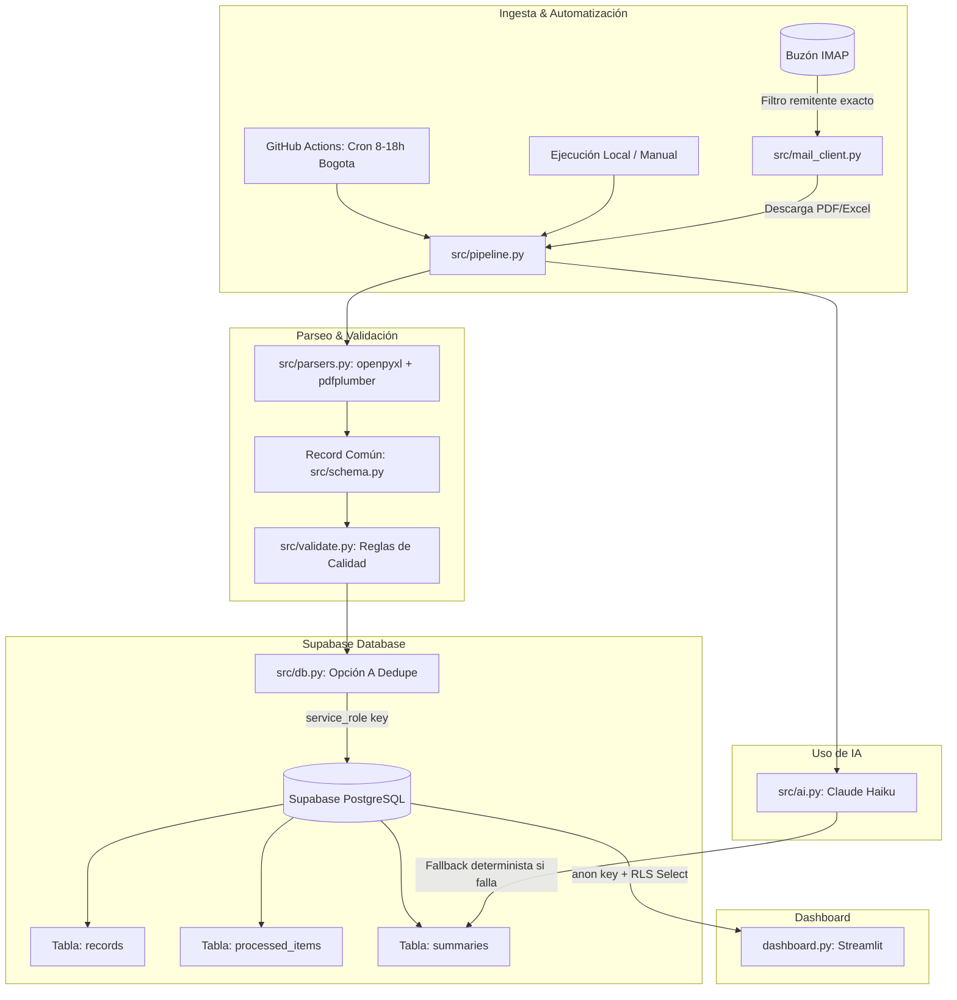

# Solución de Automatización Operacional: Correo, IA & Dashboard (Python + Supabase + Streamlit)

Solución integral y funcional para automatizar la recepción, procesamiento, validación y visualización de reportes operacionales recibidos por correo electrónico (formatos Excel y PDF), con persistencia en la nube (**Supabase**) y visualización interactiva (**Streamlit**).

---

## 1. Arquitectura General



---

## 2. Decisiones Técnicas y Justificación

### Persistencia en Supabase
- **Problema que resuelve:** A diferencia de SQLite local (que en GitHub Actions o Streamlit Cloud corre en contenedores efímeros sin compartir disco), Supabase proporciona persistencia centralizada en PostgreSQL, accesible tanto por el pipeline de ingesta como por el dashboard.
- **Deduplicación por `row_hash` (PK):** Cada fila genera una huella SHA-256 basada en `fecha|cliente|categoria|valor|estado|referencia`. Esto impide filas duplicadas aunque el mismo reporte se reenvíe.
- **Conteo con Opción A:** Antes de insertar un lote, se consultan los `row_hash` existentes en Supabase (`in_("row_hash", chunk)`). Se contabilizan exactamente las filas nuevas y duplicadas, y solo se insertan las nuevas.
- **Seguridad y Mínimo Privilegio:**
  - El **pipeline** usa `SUPABASE_SERVICE_KEY` para inserción y registro en `processed_items` (bypasseando RLS).
  - El **dashboard** usa `SUPABASE_ANON_KEY`, restringido por Row Level Security (RLS) únicamente a operaciones `SELECT` en `records` y `summaries`. `processed_items` no está expuesta al cliente anónimo.

### Automatización y Horario de Ejecución
- **Cron en horario laboral:** Programado en `.github/workflows/ingest.yml` para ejecutarse cada hora únicamente de 8:00 a 18:00 hora Colombia (`0 13-23 * * *` en UTC).
- **Ahorro de cuotas:** No se ejecutan tareas innecesarias en la noche. Los correos recibidos fuera de horario se procesan a las 8:00 a. m. del siguiente ciclo.
- **Idempotencia en 3 capas:**
  1. `Message-ID` del correo.
  2. SHA-256 del archivo adjunto.
  3. `row_hash` del registro individual.

### Uso Quirúrgico de Inteligencia Artificial
- **Dónde sí:** En la redacción del **resumen ejecutivo** en lenguaje natural. Convierte métricas precalculadas en una síntesis accionable para líderes operacionales.
- **Control de alucinaciones:** El LLM **no calcula números**; recibe un JSON generado por pandas con cifras 100% exactas y una instrucción de sistema estricta de no inventar datos.
- **Fallback determinista:** Si no se configura `ANTHROPIC_API_KEY` o hay problemas de red, se genera una plantilla determinista con los datos exactos. El pipeline **nunca falla por la IA**.
- **Dónde no:** Parseo de documentos y validaciones. Ambos se resuelven con código determinista (expresiones regulares y reglas), siendo mucho más rápido, barato y reproducible.

---

## 3. Métricas del Dashboard

El dashboard incluye los indicadores solicitados en la prueba técnica:
1. **Total de registros procesados:** Volumen de operaciones analizadas.
2. **Valor total procesado:** Suma monetaria de los registros.
3. **Registros por categoría:** Distribución por tipo de servicio/producto (gráfico de barras).
4. **Registros por estado:** Proporción de estados (gráfico circular/donut).
5. **Evolución temporal:** Serie de tiempo diaria de registros y volumen económico.

### Métricas Adicionales Justificadas
6. **Ticket promedio (`valor.mean()`):** Permite identificar el tamaño típico de cada operación y detectar variaciones anómalas en el volumen transaccional.
7. **Porcentaje de completitud (`completados / total * 100`):** Mide la eficiencia operativa del flujo de negocio.
8. **Registros con incidencias (`issues != ""`):** Indicador de calidad de datos que resalta registros incompletos, montos negativos o fechas futuras.
9. **Clientes únicos (`cliente.nunique()`):** Mide la diversificación de la cartera de clientes en el periodo analizado.

---

## 4. Instalación y Ejecución Local

### Paso 1: Clonar y configurar entorno
```bash
python -m venv .venv
# En Windows:
.venv\Scripts\activate
# En Linux/Mac:
source .venv/bin/activate

pip install -r requirements.txt
```

### Paso 2: Configurar Supabase
1. Crea un proyecto gratuito en [Supabase](https://supabase.com).
2. Ve al **SQL Editor** en el panel de Supabase y ejecuta el contenido de `supabase/schema.sql`.
3. Obtén la **Project URL**, la **anon key** y la **service_role key** desde *Project Settings > API*.

### Paso 3: Configurar variables de entorno
Copia `.env.example` a `.env` y asigna tus claves:
```bash
cp .env.example .env
```
Configura:
```env
SUPABASE_URL=https://tu-proyecto.supabase.co
SUPABASE_SERVICE_KEY=tu_service_role_key
SUPABASE_ANON_KEY=tu_anon_key

# Opcionales para demo
ANTHROPIC_API_KEY=
ALLOWED_SENDER=reportes@empresa.com
```

### Paso 4: Ejecutar Pipeline

#### Modo Demo (con archivos locales de muestra incluidos en `data/samples`):
```bash
python -m src.pipeline --local data/samples
```
*Si se ejecuta por segunda vez, los archivos y registros ya procesados se omitirán automáticamente.*
*Para regenerar los archivos de ejemplo desde cero:* `python tools/make_samples.py data/samples`.
*Para migrar una base de datos SQLite previa a Supabase:* `python tools/migrate_sqlite_to_supabase.py --sqlite data/records.db`.

#### Modo Correo Real (IMAP):
```bash
python -m src.pipeline
```

### Paso 5: Iniciar Dashboard
```bash
streamlit run dashboard.py
```

### Paso 6: Ejecutar Pruebas Automatizadas
```bash
pytest
```
*Los tests incluyen un emulador en memoria de Supabase para ejecutarse de inmediato sin necesidad de conexión a internet.*

---

## 5. Despliegue Gratuito

### 1. Ingesta Automática (GitHub Actions)
1. Sube este repositorio a GitHub.
2. Configura los secretos en *Settings > Secrets and variables > Actions*:
   - `SUPABASE_URL`
   - `SUPABASE_SERVICE_KEY`
   - `IMAP_HOST`, `IMAP_USER`, `IMAP_PASSWORD`, `ALLOWED_SENDER`
   - `ANTHROPIC_API_KEY` (opcional)
3. El workflow `.github/workflows/ingest.yml` correrá automáticamente cada hora de 8:00 a 18:00 (hora Bogotá) o manualmente mediante `workflow_dispatch`.

### 2. Dashboard Público (Streamlit Community Cloud)
1. Conecta tu repositorio en [Streamlit Cloud](https://share.streamlit.io).
2. Configura los *Secrets* en la plataforma:
   ```toml
   SUPABASE_URL = "https://tu-proyecto.supabase.co"
   SUPABASE_ANON_KEY = "tu_anon_key"
   ```
3. El dashboard se desplegará de forma gratuita y leerá en tiempo real los datos consolidados por GitHub Actions.

---

## 6. Limitaciones Conocidas
- **Pausa de inactividad en Supabase:** En el plan gratuito, si la base de datos pasa 7 días sin peticiones se pausa temporalmente. El cron horario evita esto de lunes a domingo.
- **Layout de PDFs:** El parser soporta tablas estándar y texto sin bordes formateado como `fecha cliente REF categoría valor estado`. Variaciones drásticas en la disposición del PDF requieren ajustar la expresión regular en `src/parsers.py`.
- **Contraseñas de aplicación IMAP:** Cuentas con 2FA requieren contraseñas de aplicación dedicadas generadas en la cuenta del proveedor de correo (Google / Microsoft).
