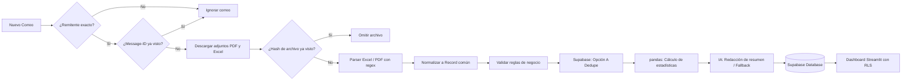
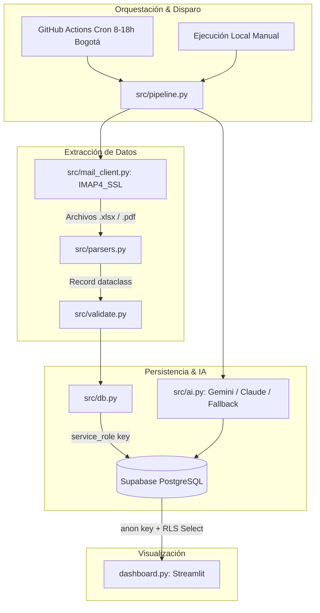

# Arquitectura del Sistema

Este documento describe la arquitectura técnica, el modelo de datos relacional y los mecanismos de seguridad implementados en **Solucion_entrega**.

---

## 1. Modelo de Datos Común (PostgreSQL en Supabase)

### Tabla `public.records` (Registros Operacionales)
| Campo | Tipo SQL | Descripción |
|---|---|---|
| `row_hash` | `text PRIMARY KEY` | Hash SHA-256 de los campos de negocio (`fecha\|cliente\|categoria\|valor\|estado\|referencia`). Garantiza deduplicación absoluta. |
| `fecha` | `date` | Fecha normalizada en formato ISO (`YYYY-MM-DD`). |
| `cliente` | `text` | Nombre o razón social del cliente. |
| `categoria` | `text` | Categoría del servicio o producto. |
| `cantidad` | `integer` | Unidades operadas (específico de archivos Excel). |
| `referencia` | `text` | Código de referencia o folio (específico de archivos PDF). |
| `valor` | `numeric` | Importe monetario normalizado como número decimal. |
| `estado` | `text` | Estado de la operación (`Completado`, `Pendiente`, etc.). |
| `issues` | `text` | Incidencias detectadas durante la validación (ej. `falta cliente; valor no positivo`). |
| `source_file` | `text` | Nombre del archivo de origen para auditoría y trazabilidad. |
| `source_type` | `text` | Tipo de formato de origen (`xlsx` o `pdf`). |
| `ingested_at` | `timestamptz` | Marca de tiempo de inserción en base de datos (`DEFAULT now()`). |

### Tabla `public.processed_items` (Control de Idempotencia y Auditoría)
| Campo | Tipo SQL | Descripción |
|---|---|---|
| `item_id` | `text PRIMARY KEY` | Identificador único (`mail:<Message-ID>` o `file:<SHA-256>`). |
| `kind` | `text` | Tipo de elemento registrado (`mail` o `file`). |
| `detail` | `text` | Resultado del procesamiento (ej. `"12 nuevos, 1 duplicados"` o mensaje de excepción). |
| `status` | `text` | Estado del proceso (`ok` o `error`). |
| `processed_at` | `timestamptz` | Fecha y hora del procesamiento (`DEFAULT now()`). |

### Tabla `public.summaries` (Resúmenes Ejecutivos de IA)
| Campo | Tipo SQL | Descripción |
|---|---|---|
| `id` | `bigserial PRIMARY KEY` | Identificador secuencial del resumen. |
| `text` | `text` | Contenido del resumen ejecutivo redactado en lenguaje natural. |
| `model` | `text` | Modelo generador (`gemini-2.5-flash`, `claude-haiku-5-5` o `fallback`). |
| `created_at` | `timestamptz` | Fecha de generación (`DEFAULT now()`). |

---

## 2. Diagramas de Flujo y Componentes

### Flujo Lógico de Procesamiento

### Arquitectura de Componentes

---

## 3. Modelo de Seguridad por Capas

1. **Validación de Identidad de Correo:** Se analiza la dirección RFC 2822 (`parseaddr`) del encabezado `From` del correo, evitando la suplantación de identidad basada en nombres visibles.
2. **Principio de Mínimo Privilegio (RLS):**
   - El pipeline utiliza `SUPABASE_SERVICE_KEY` en entornos seguros de servidor para realizar inserciones y registrar auditoría completa.
   - El dashboard público solo posee la clave `SUPABASE_ANON_KEY`, restringida por políticas de Row Level Security a lecturas `SELECT` en las tablas `records`, `summaries` y las filas de tipo `file` en `processed_items`. Los identificadores de correo (`kind='mail'`) permanecen completamente privados.
3. **Manejo de Secretos:** No se almacenan claves en el código ni en el repositorio. Todas las credenciales se inyectan mediante variables de entorno (`.env` local ignorado por Git, secretos de GitHub Actions y secrets de Streamlit Cloud).
4. **Ejecución Segura de Adjuntos:** Los archivos recibidos se validan por extensión estricta (`.pdf`, `.xlsx`, `.xlsm`) y se leen como secuencias de bytes binarios pasivos mediante librerías de solo lectura, impidiendo la ejecución de código arbitrario.
